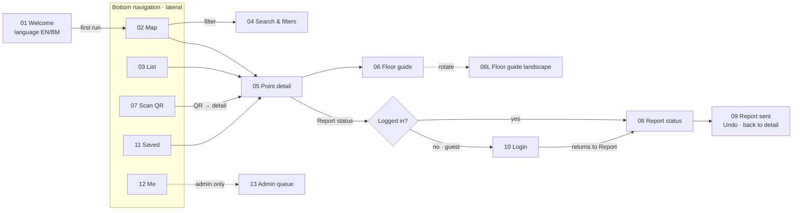

# UM Refill — Design Brief (Phase 1, v0.1)

> Live design canvas (wireframes, flow map, design system, storyboard):
> https://claude.ai/artifact/UfTE5Lbjj5TarAgfLjEuYk
>
> WIA2007 Mobile Application Development · Semester 1, 2026/2027

---

## 1. Product

UM Refill shows which water refill points around Universiti Malaya are working right now, and lets anyone standing at one update its status in three taps.

- **Proposed SDG alignment:** SDG 6, target **6.b**: support and strengthen the participation of local communities in improving water management. Fallback: 13.3 (awareness).
- **Floor guide = a static plan with pins.** It is **not** live navigation: no indoor positioning, no "you are here", no turn-by-turn directions.

### Personas (draft: validate in the user study)

| Persona | Role | Context | Main need |
|---|---|---|---|
| **Aina, 20** | Student, finder | Year 1, lives in a residential college, 10 minutes between classes | The nearest working point, now, without logging in |
| **Daniel, 24** | International student, newcomer | Master's student, reads English, red-green colour-blind | The floor and spot inside a building; a status he can read without colour |
| **Dr. Rosnah, 48** | Lecturer, reporter | Prefers Bahasa Melayu and larger text | Report a fault in seconds and see it was received |
| **En. Faizal, 39** | Facilities staff, admin | Maintenance technician (e.g. JPPHB) covering several buildings | A queue showing which reports are likely real faults first |

---

## 2. Hard rules

Every screen is checked against these.

1. **3 taps, under 10 s:** QR sticker → submitted status: *Scan → Report status → status button*. The status button submits immediately, with **Undo** (5 s).
2. **Map usable within 2 s** of launch: bundled map image + last cached statuses first, network refresh after.
3. **Status = icon + word + colour, always.** Never colour alone, including map pins (every pin has an icon).
4. **English and Bahasa Melayu.** All copy in `res/values/strings.xml` + `res/values-ms/`; layouts tested with the longer BM strings.
5. **48dp minimum touch targets**, including map pins (36dp visual, 48dp hit area) and chips.
6. **Material 3 with Java + XML.** Material Components for Android (`Theme.Material3.*`), `ConstraintLayout` roots.
7. **Browse without login.** Map, list, detail, floor guide and scan are open. Only **reporting** and **admin** need login; saved points stay on the device.

---

## 3. Data & navigation

### Data model

**RefillPoint**
`id · qrCode · nameEn · nameMs · building · floor · zone · mapX% · mapY% · floorPlanId · floorX% · floorY% · waterTypes[cold, hot, room] · filtered · wheelchairHeight · status · statusUpdatedAt · reportsToday · photoUrl`

**Report**
`id · pointId · userId · status (Available | Low | Empty | Faulty) · photoUrl? · note? · createdAt · aiHint? · likelyFaultyScore (0–1) · adminState (new | verified | fixed | rejected)`

**User / device**
`User: id · role (student | staff | admin) · displayName · reportCount`
`Device (no login): language (en | ms) · textScale · savedPointIds[] · cachedPoints + cachedAt`

A point shows **Unknown** when `statusUpdatedAt` is older than the stale window (open question 1).

### What each screen shows

| Screen | Fields |
|---|---|
| 02 Map | pin (mapX/Y, status icon) · nearest card: name, building + floor, distance, status, updated-ago |
| 03 List · 11 Saved | name, building + floor, distance, status badge, updated-ago, water-type icons |
| 04 Filters | status, waterTypes, filtered, wheelchairHeight, zone |
| 05 Point detail | photo, name (EN/BM), building, floor, status, statusUpdatedAt, waterTypes, filtered, wheelchairHeight, last 3 reports |
| 06 Floor guide | floor plan image, floor list, pins (floorX/Y + status), point name |
| 07 Scan | qrCode → pointId lookup (works offline from cache) |
| 08 Report · 09 Sent | point name + current status, status choice, optional photo + note, aiHint |
| 12 Me | displayName, role, reportCount, language, textScale |
| 13 Admin queue | report status, point, createdAt, reporter count, likelyFaultyScore → badge, photo, adminState |

### Bottom navigation (5 tabs, lateral)

**Map · Peta** | **List · Senarai** | **Scan · Imbas** (centre, one-thumb reach) | **Saved · Simpan** | **Me · Saya**

Everything else is descendant (pushed) from these.

### Flow map

After login, the app opens Report for **the same point**, so the guest loses no progress.

---

## 4. Screens (13 + landscape floor plan)

| # | Screen | Purpose |
|---|---|---|
| 01 | Welcome & language | First run only. Pick EN/BM; "Start browsing" without an account; optional login. |
| 02 | Map (home) | Campus map with status pins, search, filter chips, and a **nearest working point** card above the tab bar. |
| 03 | List | Points sorted by distance with status badges; sort/hide-broken chips. |
| 04 | Search & filters | Bottom sheet: search, status, water type, filtered, wheelchair height, zone. |
| 05 | Point detail | Photo, status block, info grid, Floor guide, directions to the building, recent reports, **Report status** button. |
| 06 | Floor guide | Static floor plan with pins, floor switcher, "not live navigation" notice. |
| 06L | Floor guide (landscape) | Larger plan; side panel with floors and point info (`layout-land`). |
| 07 | Scan QR | Camera viewfinder; auto-reads the station sticker and opens its detail. No login needed. |
| 08 | Report status | Four large status buttons (one tap submits). **AI hints:** a history hint ("usually runs Low at lunchtime") and an optional photo check ("looks like an empty tank, mark Empty?"). Optional note. |
| 09 | Report sent | Confirmation, Undo snackbar (5 s), "find next nearest" / "back to point". |
| 10 | Login | Reached by the guest redirect; explains why; returns straight to Report. |
| 11 | Saved | Points bookmarked on this device; no login. |
| 12 | Me & settings | Profile, language, text size, notifications, admin entry (admin role only), log out. |
| 13 | Admin queue | New / Verified / Fixed tabs; **"Likely faulty"** badge sorts real faults first; Confirm / Mark fixed / Refilled / Reject. |

AI is always labelled with a sparkle icon and is a **suggestion the user accepts**, never an automatic change.

---

## 5. Design system (starter)

Implemented in `app/src/main/res/values/colors_umrefill.xml`, `dimens_umrefill.xml`, `strings_status.xml` (+ `values-ms/`) and `drawable/ic_status_*.xml`.

### Colour roles

| Role | Hex | Use |
|---|---|---|
| primary | `#0B3B66` | UM navy; filled buttons, selected states |
| onPrimary | `#FFFFFF` | |
| primaryContainer / on | `#D6E4F5` / `#0B2A47` | tonal buttons, selected chips, active tab pill |
| tertiary (UM gold) | `#F2B705` | accents only (Undo, scan line) |
| error | `#B3261E` | form errors only, never a refill status |
| surface | `#F7F9FC` | screen background |
| surfaceContainer | `#EEF2F7` | hint cards, table headers |
| onSurface / variant | `#1A1F26` / `#4A5361` | text |
| outline / variant | `#C4CBD4` / `#DDE2E8` | borders |

### Status tokens (colour-blind safe, Okabe-Ito based)

| Status | BM | Pin fill | Pin icon | Badge text on tint | Icon | L* |
|---|---|---|---|---|---|---|
| Available | Tersedia | `#006B4F` | white | `#00573F` on `#D8F1E8` | check | 40 |
| Low | Hampir habis | `#E69F00` | `#3D2800` | `#6B4500` on `#FCEFD2` | half drop | 72 |
| Empty | Kosong | `#D55E00` | white | `#9A3600` on `#FBE3D6` | crossed drop | 55 |
| Faulty | Rosak | `#7A2E63` | white | `#6E2859` on `#F5E1EE` | wrench | 31 |
| Unknown | Tidak diketahui | white, dashed `#5F6773` outline | `#3F4650` | `#3F4650` on white, dashed | question mark | outlined |

Status colours differ in **lightness** as well as hue, so they remain separable in greyscale, and the icon + word carry the meaning anyway.

### Type scale (Roboto, sp)

| Token | Size / line | Example |
|---|---|---|
| headlineSmall | 24/32 | Screen titles |
| titleLarge | 22/28 | Point name on detail |
| titleMedium | 16/24 · 500 | Card titles |
| bodyLarge | 16/24 | Body |
| bodyMedium | 14/20 | Secondary text |
| labelLarge | 14/20 · 500 | Buttons |
| labelMedium | 12/16 · 500 | Tab labels; **minimum size** |

### Spacing & shape (dp)

- Spacing: **4 · 8 · 12 · 16 (screen margin) · 24 · 32**; minimum touch target **48**.
- Corners: XS 4 · S 8 (chips) · M 12 (cards) · L 16 (FAB) · XL 28 (sheets) · full (buttons).
- Elevation: cards level 1 (or outline); nearest card and sheets level 2; FAB level 3.

### Components

- **Map pin:** 36dp circle with status icon in a 48dp hit area; selected = 48dp with navy ring; cluster pin shows a count.
- **Status badge:** pill, icon + word, tint background (see table).
- **Filter chips:** 32dp visual / 48dp touch; selected = tonal fill **and** check icon.
- **Nearest-point card:** "Nearest working · distance", status badge, name, types, updated-ago; skips Empty/Faulty points.
- **Buttons:** filled = the one primary action per screen; tonal = secondary; outlined = leaves the app.
- **AI hint card** (sparkle icon, surfaceContainer) and **"Likely faulty" badge** (Faulty fill, white text).
- **Floor switcher** (segmented) and **Undo snackbar** (5 s).

---

## 6. 3-tap storyboard

Dr. Rosnah is at an empty dispenser and is already logged in.

| Step | Time | What happens |
|---|---|---|
| Start | 0 s | App opens on Map (cached, < 2 s). Scan is the centre tab. |
| **Tap 1 · Scan** | ~2 s | Camera opens; the QR sticker is read automatically (no shutter). |
| Auto | ~4 s | Point detail opens with a short vibration; "Report status" sits at the bottom. |
| **Tap 2 · Report** | ~5 s | Four 88dp status buttons; the AI hint is read-only and never blocks. |
| **Tap 3 · Empty** | ~8 s | Sent on tap; map updates for everyone; Undo for 5 s replaces "Are you sure?". |

- **Guest exception:** the first report adds one Login step after Tap 2, then returns to the status buttons.
- **Finding water is 0–1 taps:** the nearest working point is on the Map card at launch.
- **Test it:** time 5 users from unlock to the Undo snackbar; record the median in the NFR section of the report.

---

## 7. Android component per screen

Every screen root is a `ConstraintLayout`. Tabs = one `MainActivity` with `BottomNavigationView` swapping Fragments; pushed screens are Activities opened with explicit Intents (`putExtra("pointId", id)`).

| Screen | Host | Key components |
|---|---|---|
| 01 Welcome | `WelcomeActivity` | `MaterialButtonToggleGroup` (EN/BM) · `MaterialButton` · `AppCompatDelegate.setApplicationLocales()` · SharedPreferences `firstRun` |
| 02 Map | `MapFragment` | `ImageView` (bundled map in `res/drawable`) + pin `ImageButton`s placed by constraint bias = mapX/Y% (or PhotoView for pinch-zoom) · `ChipGroup` · `MaterialCardView` (nearest) · small `FloatingActionButton` ×2 · `FusedLocationProviderClient` |
| 03 List | `ListFragment` | `RecyclerView` + Adapter (item: `MaterialCardView` with status chip) · `ChipGroup` (sort, singleSelection) · `SwipeRefreshLayout` |
| 04 Search & filters | `BottomSheetDialogFragment` | `SearchBar`/`SearchView` · `ChipGroup` (multi-select) · `Spinner` or exposed-dropdown `TextInputLayout` · `MaterialButton` |
| 05 Point detail | `PointDetailActivity` | `MaterialToolbar` · `ImageView` · status `MaterialCardView` · `GridLayout` info cells · filled/tonal/outlined `MaterialButton` · implicit `ACTION_VIEW geo:` for directions · refresh in `onResume()` |
| 06 / 06L Floor guide | `FloorGuideActivity` | `MaterialButtonToggleGroup` (floors) · `ImageView` + pins by bias · `res/layout-land/activity_floor_guide.xml` · `onSaveInstanceState` keeps the floor on rotation |
| 07 Scan QR | `ScanFragment` | CameraX `PreviewView` + ML Kit Barcode Scanning (QR only) · CAMERA runtime permission · torch · explicit Intent to `PointDetailActivity` on match |
| 08 Report status | `ReportActivity` | 4 `MaterialButton`s in a 2×2 grid (each submits) · AI hint `MaterialCardView` · `ActivityResultContracts.TakePicture` · ML Kit Image Labeling (on-device) or cloud API · `TextInputLayout` note |
| 09 Report sent | `ReportActivity` (state) | `Snackbar` with Undo (5 s) · `MaterialButton` |
| 10 Login | `LoginActivity` | `TextInputLayout` + `TextInputEditText` (`textEmailAddress`/`textPassword`) · started via `registerForActivityResult` so Report resumes after login |
| 11 Saved | `SavedFragment` | `RecyclerView` (same item as List) · Room or SharedPreferences for `savedPointIds` · empty-state `TextView` |
| 12 Me | `MeFragment` | `MaterialCardView` · `MaterialButtonToggleGroup` (language, text size) · `MaterialSwitch` · role check hides admin row |
| 13 Admin queue | `AdminQueueActivity` | `TabLayout` (New/Verified/Fixed) · `RecyclerView` of `MaterialCardView` · "Likely faulty" `Chip` when score ≥ threshold · `MaterialButton` actions |

**Status rendering rule:** one helper/`StatusView` sets icon + string + colour together from a `Status` enum, so no screen can show colour alone.

---

## 8. Open design questions

1. **Stale window.** After how long without a report does a point fall back to Unknown? 4 h, end of day, 24 h?
2. **Who may report?** UM login only (as designed), or anonymous with a rate limit?
3. **"Nearest" indoors.** GPS outdoors, last scanned/selected building indoors?
4. **Campus map source.** Which 2D map and scale; how pin x/y % are measured and maintained; who draws floor plans?
5. **QR stickers.** Who prints and places them, what they encode (pointId only?), what happens when one is missing.
6. **AI hints.** On-device ML Kit vs a cloud vision API; acceptable accuracy and how to evaluate on real UM photos; how `likelyFaultyScore` is calculated.
7. **Photo privacy.** Blur faces, crop, or warn? Retention period?
8. **Admins.** A real UM unit (JPPHB, college office) or the team for the demo? Verified vs Fixed, or just Fixed?
9. **BM wording.** Confirm Tersedia / Hampir habis / Kosong / Rosak / Tidak diketahui with native speakers.
10. **Offline.** Queue reports offline, or require a connection?
11. **Dark mode** in v1 or later? (Needs a dark status palette.)
12. **SDG target.** 6.b assumed; 13.3 as fallback. Agree as a team.
